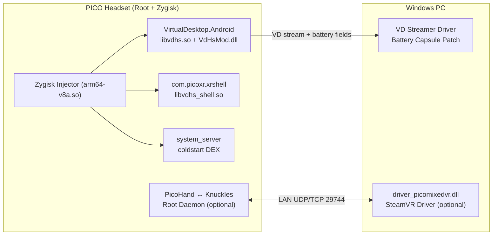

<div align="center">

# VD-PicoEnhance

**PICO optical hand tracking, Quest-style hand passthrough, eye-gaze pointer fixes, unlocked bitrate/resolution, and SteamVR controller battery for unmodified Virtual Desktop.**

[](LICENSE)
[](#requirements)
[](https://github.com/WolalaQAQ/VD-PicoEnhance/releases/latest)

**English** | [简体中文](README_zh.md)

[Quick Start](#quick-start) · [Features](#features) · [Everyday Usage](#everyday-usage) · [Configuration](#configuration) · [FAQ](#troubleshooting--known-issues) · [Developer Guide](#developer-guide) · [Community](#community)

</div>

---

VD-PicoEnhance is a Magisk/Zygisk module that adds missing PICO features to the official `VirtualDesktop.Android` app at runtime. The official APK stays untouched on disk.

> [!NOTE]
> Tested on **PICO 4 Pro** (PICO OS 5.13.7) with Virtual Desktop **1.34.22.0 / 1.34.25.0**, and community-confirmed on **PICO 4** ([PR #2](https://github.com/WolalaQAQ/VD-PicoEnhance/pull/2#issuecomment-6263664529)). Requires root with Zygisk enabled.

## Features

### Hand Tracking, Passthrough & Eye Gaze

- **PICO optical hand tracking**: Exposes `XR_EXT_hand_tracking` to Virtual Desktop, synthesizes `XR_FB_hand_tracking_aim` (pinch, pointing ray, and palm-facing menu gesture, preferring the runtime's own aim when valid), and supplies `XR_FB_hand_tracking_mesh` from a bundled hand mesh (`hand_mesh_fb.bin`).
- **Controller / hand hot-switch**: Put a PICO controller down to switch to hands; pick it back up to return to controllers.
- **Quest-style hand passthrough**: Renders per-hand projected passthrough layers inside Virtual Desktop, and cuts an in-place, zero-copy alpha hole in the streamed VR swapchain inside SteamVR. Follows VD's own `VRPassthroughHands` rules and leaves non-VR views untouched.
- **Joint freeze gate**: Marks a hand inactive when joint data stops updating (default `300 ms`), avoiding stuck or flashing hand models.
- **Eye-gaze pointer fix** *(eye-tracking hardware only)*: Applies One-Euro smoothing, jump confirmation, and head-pose compensation strictly to VD's UI pointer. Foveated streaming and eye-tracking forwarding pass through untouched.

### Bitrate & Resolution Unlock

- **3× bitrate ceiling**: Extends VD's native Desktop and VR bitrate sliders to roughly three times the stock upper limits without altering current selections or adding extra switches. Measured bandwidth limits and encoder caps still apply.
- **Higher resolution tiers**: Unlocks VD's native **Monster** (3840×3840), **Rampage** (4416×4416), and **Unstoppable** (5184×5184) per-eye reference tiers directly on the existing Quality slider.

### Quality of Life

- **PICO controller battery in SteamVR**: Reports real PICO controller battery levels to SteamVR through a local patch applied to your PC copy of VD's OpenVR driver.
- **Chinese UI**: Automatically switches VD's control panel and SteamVR performance overlay to Simplified Chinese when the headset language is Chinese, while keeping game/file names, paths, clocks, and telemetry intact.
- **Hand-mode VD startup**: On PICO OS 5.13.7, declares VD as hand-tracking compatible in system memory so you can launch VD directly while in system hand mode.
- **System gesture suppression** *(experimental, off by default)*: Adds a **Suppress system gestures** toggle under VD's **Input** tab to block accidental PICO recenter/dock gestures while VD is focused.

### Optional: PicoHand<->Knuckles Auto-Switch

If you use **Valve Index controllers (Knuckles)** alongside PICO optical hand tracking, the optional **PicoHand<->Knuckles** module switches between them automatically:

- **Pick up** an Index controller (touch trackpad while moving) → turns off PICO system hand tracking and system gestures.
- **Put down** all active Index controllers (release trackpads and hold still for 1 second) → restores PICO hand tracking.

The PC side is a lightweight SteamVR driver (`driver_picomixedvr`) that communicates with a root daemon on the headset over your local network (port `29744`). No ADB, VD video frames, or extra background app is required during daily use. See [PC Setup & Daily Use](docs/PC-SETUP.md) for details.

## Requirements

| Component | Requirement |
|---|---|
| Headset | **PICO 4** or **PICO 4 Pro** (`arm64-v8a`); eye-gaze fixes require eye-tracking hardware |
| Root | Magisk ≥ 27000 with **Zygisk** enabled (API v5), or standalone Zygisk (e.g. ReZygisk / NeoZygisk) |
| Virtual Desktop (Headset) | Official unmodified `VirtualDesktop.Android` **1.34.22.0** or **1.34.25.0** |
| PC (Install & Daily Use) | Windows x64, Virtual Desktop Streamer **1.34.22.0** or **1.34.25.0**, SteamVR, and `adb` (Android platform-tools) |
| Hand-Mode Startup & Knuckles | PICO OS 5.13.7 (`Pico/Phoenix/PICOA8110:10/5.13.7/smartcm.1761755159:user/dev-keys`); Knuckles also requires Valve Index controllers and a private LAN |

## Quick Start

1. Download `VD-PicoEnhance-v<version>.zip` from [Releases](https://github.com/WolalaQAQ/VD-PicoEnhance/releases/latest) and extract the entire archive to a folder on your PC.
2. Exit **Virtual Desktop** and **SteamVR**, then connect your headset via USB or authorized wireless ADB (with shell root granted in Magisk).
3. Open a regular PowerShell window in the extracted folder—using the same Windows account that runs SteamVR—and run:

```powershell
# Base install: VD-PicoEnhance + PICO controller battery in SteamVR
powershell -NoProfile -ExecutionPolicy Bypass -File .\install-vd-picoenhance.ps1

# Base install + optional PicoHand<->Knuckles auto-switcher
powershell -NoProfile -ExecutionPolicy Bypass -File .\install-vd-picoenhance.ps1 -WithKnuckles
```

The installer patches your local PC copy of VD's OpenVR driver (prompting for administrator approval only for PC file writes), flashes the Magisk module, installs the hand mesh if missing, and reboots the headset once. Everything comes from the extracted folder; nothing is downloaded.

> [!TIP]
> Common installer flags: `-Adb 'C:\path\to\adb.exe'` if `adb` is not on `PATH`, `-Serial <id>` when multiple devices are connected, `-DriverPath <dll>` for a nonstandard Streamer path, `-NoReboot` to skip automatic reboot, and `-HeadsetAddress` / `-PcAddress` if auto-detected LAN IPs pick the wrong adapter. Full setup, daily use, and upgrade instructions live in [docs/PC-SETUP.md](docs/PC-SETUP.md).

After reboot, launch Virtual Desktop and SteamVR normally. Upgrades use the exact same command from the new release bundle; if PicoHand<->Knuckles is already installed, it upgrades automatically without repeating `-WithKnuckles`.

## Everyday Usage

### Bitrate & Resolution Sliders

Extended ranges are active automatically on VD's original **Settings → Desktop Bitrate**, **Streaming → VR Bitrate**, and **Streaming → VR Graphics Quality** sliders. Stock lower values remain available, and your existing selections are not raised automatically.

- **Manual extended bitrate**: Turn off **Automatically adjust bitrate** in Virtual Desktop Streamer on your PC; otherwise Streamer can still throttle the stream below your slider setting. Increase gradually while watching network and decode latency.
- **Performance overlay readings**:
  - **Max bitrate** displays `min(extended ceiling, measured bandwidth)`. It is an upper bound, not live throughput.
  - **Render resolution %** compares PC render width against the *currently active quality tier's* reference width (Monster 3840, Rampage 4416, Unstoppable 5184). The same PC render width shows a smaller percentage at higher tiers.
- **Applying resolution changes**: Restart VR streaming when prompted by VD. Extended choices are stored in `/data/data/VirtualDesktop.Android/vdhs/streaming_limits.txt` and restored silently.

### System Gesture Suppression

Open **Input → Suppress system gestures** inside Virtual Desktop. The switch defaults to **off**, remembers your choice, and applies within 1–2 seconds without restarting VD or the headset. Turning it off immediately restores PICO's recenter/dock gestures.

### Chinese UI

Localization follows the headset's system language automatically when VD launches. Restart VD after changing the system language.

### Hand Visibility in VD 1.34.25.0

Virtual Desktop 1.34.25.0 activates its built-in automatic hand-hiding timer. If your hands fade out while idle and you want them visible, turn off **Automatically hide hands** in VD's **Input** tab.

## Troubleshooting & Known Issues

- **Pinch (trigger) does not switch the main hand in SteamVR**: With an open hand, the synthesized trigger rests around `0.27` instead of `0`, while VD requires an exact `1.0` digital click transition. A managed-layer dead-zone remap is planned.
- **Eye gaze drifts slightly when turning your head**: Residual head-rotation drift remains under active head movement.
- **Hands flash and disappear after long use**: The OpenXR runtime or SteamVR occasionally freezes hand joints for an extended period. Restarting SteamVR recovers tracking.
- **PICO shows "gestures not supported" when launching VD in hand mode**: Verify that your firmware matches the supported PICO OS 5.13.7 fingerprint and that the startup helper is active (see [Hand-mode startup CLI](#advanced-options)).
- **VD Streamer updated and controller battery disappeared**: A Streamer update overwrites the patched PC driver. Exit SteamVR and re-run `install-vd-picoenhance.ps1` from a release bundle that supports the new Streamer version.
- **VD Android updates**: Internal method names are version-specific; an untested VD update may disable the compatibility layer until adapted.
- **Roadmap — USB wired streaming**: VD 1.34.22+ supports USB NCM wired streaming, which PICO does not expose to apps by default. Bringing up a headset USB network interface for VD is under investigation.

## Uninstall & Rollback

Exit Virtual Desktop and SteamVR, connect your headset via ADB, and run from the extracted release folder:

```powershell
# Remove everything (restores original PC VD driver, removes headset module & Knuckles if installed)
powershell -NoProfile -ExecutionPolicy Bypass -File .\install-vd-picoenhance.ps1 -Action Uninstall

# Remove only PicoHand<->Knuckles (keeps VD-PicoEnhance and controller battery)
powershell -NoProfile -ExecutionPolicy Bypass -File .\install-vd-picoenhance.ps1 -Action UninstallKnuckles
```

To temporarily pause **PicoHand<->Knuckles** without uninstalling, run `-Action Disable` (`-Action Enable` turns it back on).

To disable the headset module manually in Magisk, toggle it off in Magisk Manager—or run `touch /data/adb/modules/vdhs_zygisk/disable` as root—and reboot. Once disabled or removed, you may delete `/data/data/VirtualDesktop.Android/vdhs/` to clear staged files, saved switches, `hand_gesture.txt`, and any custom mesh.

---

## Configuration

All default features work out of the box without any config file. To tune runtime behavior, copy only the keys you want to override from [`config/hand_gesture.example.txt`](config/hand_gesture.example.txt) into:

```text
/data/data/VirtualDesktop.Android/vdhs/hand_gesture.txt
```

Restart Virtual Desktop after editing. Missing keys keep their built-in defaults, and explicit values are preserved across upgrades.

<details>
<summary><strong>Runtime configuration keys (<code>hand_gesture.txt</code>)</strong></summary>

| Key | Default | Description |
|---|---|---|
| `pt_hole` | `1` | Draw zero-copy hand-passthrough alpha holes in SteamVR (`0` disables) |
| `pt_follow_settings` | `1` | Draw holes only when VD's own `VRPassthroughHands` condition is active |
| `pt_bg_fix` | `1` | Restore background passthrough state when no hand hole is drawn |
| `pt_split` | `1` | Use one projected layer per hand inside VD so both hands stay visible |
| `pt_disc_r` / `pt_margin_px` / `pt_flip_y` / `pt_max_age_ms` | `0.1` / `0` / `0` / `100` | Passthrough disc radius (m), extra pixel margin, vertical flip, and max hand-sample age |
| `hj_freeze_ms` | `300` | Mark a hand inactive if joints do not move for this many ms (`0` disables) |
| `gaze_vd_fix` / `gaze_filter` | `1` / `1` | UI-pointer head-pose compensation and One-Euro smoothing (streaming gaze always passes through) |
| `gaze_beta` / `gaze_mincutoff` / `gaze_jump_deg` / `gaze_hold_ms` | `0.01` / `1.0` / `8` / `120` | One-Euro filter tuning, fixation jump threshold, and invalid-sample hold time |
| `aim_runtime` / `aim_shoulder` / `aim_smooth` / `aim_pitch_deg` | `1` / `1` / `0.2` / `0` | Prefer runtime aim when valid; shoulder→index ray, smoothing, and pitch offset |
| `pinch_on_cm` / `pinch_off_cm` / `pinch_full_cm` | `0.4` / `0.8` / `3.0` | Fingertip gap thresholds (`0 <= on < off <= full`); invalid groups reset to defaults |
| `menu_pinch_cm` / `menu_hold_ms` / `menu_cooldown_ms` | `0.6` / `500` / `300` | Palm-facing menu pinch distance, hold time, and repeat cooldown |
| `gaze_log` / `pt_alpha_only` / `pt_style` | `0` | Diagnostic flags (keep `0` for normal use) |

</details>

### Advanced Options

<details>
<summary><strong>Hand-mode startup CLI (<code>coldstart.sh</code>)</strong></summary>

Check or toggle the `system_server` metadata helper as root on the headset:

```sh
sh /data/adb/modules/vdhs_zygisk/coldstart.sh status   # expect applied or native, int1, ok
sh /data/adb/modules/vdhs_zygisk/coldstart.sh query    # expect metadata-query int1 ok
sh /data/adb/modules/vdhs_zygisk/coldstart.sh disable  # restore original metadata and save choice
sh /data/adb/modules/vdhs_zygisk/coldstart.sh enable   # re-enable
```

Explicit choices survive module upgrades.

</details>

<details>
<summary><strong>Customizing or disabling Chinese UI (<code>ui_zh.txt</code>)</strong></summary>

Edit `/data/adb/modules/vdhs_zygisk/payload/ui_zh.txt` as root and restart VD. Each line uses `English<TAB>Chinese`, with literal `\n` for line breaks. Delete the file and restart VD to disable localization.

</details>

<details>
<summary><strong>Replacing or generating the hand mesh (<code>hand_mesh_fb.bin</code>)</strong></summary>

The module installs the bundled `hand_mesh_fb.bin` into `/data/data/VirtualDesktop.Android/vdhs/hand_mesh_fb.bin` automatically if missing and keeps any existing copy.

- Replace using the installer: pass `-MeshPath <file>` to `install-vd-picoenhance.ps1`.
- Generate from your own headset's `XRShell.apk` (requires Python 3 + NumPy):

```sh
python tools/mesh/xrshell_mesh.py blob --apk /path/to/XRShell.apk --out out
```

See [`assets/mesh/README.md`](assets/mesh/README.md) for manual push steps, SHA-256 verification, and provenance.

</details>

<details>
<summary><strong>Headset-only install & smoke-test mode (<code>mode.txt</code>)</strong></summary>

- **Headset-only install**: Pass `-HeadsetOnly` to `install-vd-picoenhance.ps1`, or flash `vdhs_zygisk.zip` directly in Magisk Manager (**Modules → Install from storage**) and reboot. This skips PC battery patching and PicoHand<->Knuckles.
- **Injection smoke test (`Mode 1`)**: Pass `-Mode 1` to the installer, or set `/data/adb/modules/vdhs_zygisk/payload/mode.txt` to `1` as root and reboot. Mode `1` verifies Zygisk injection and Mono reachability without starting the compatibility layer, Shell receiver, or startup helper. Set back to `2` and reboot to re-enable full mode.

</details>

## Developer Guide

### How It Works



Inside `VirtualDesktop.Android`, `libvdhs.so` installs ShadowHook inline hooks on VD's bundled `libopenxr_loader.so` exports in memory, reaches the PICO runtime (`xrMarkApiClass`), synthesizes FB aim/mesh data, writes zero-copy passthrough holes, filters UI-only eye gaze, and populates controller battery bytes. `VdHsMod.dll` uses reflection only—with zero compile-time dependency on VD/Xenko assemblies—to inject extension entries, widen bitrate/quality sliders, localize UI strings, and render the in-app gesture toggle.

For full component details, hook tables, and protocol design, see [`docs/ARCHITECTURE.md`](docs/ARCHITECTURE.md) and [`mod/README.md`](mod/README.md).

### Directory Structure

| Path | Contents |
|---|---|
| `mod/native/` | VD payload (`libvdhs.so`), Shell receiver (`libvdhs_shell.so`), capability policy, symbol resolver, vendored ShadowHook 2.0.1 |
| `mod/src/VdHsMod/` | Managed mod (`netstandard2.0`, reflection-only, offline-safe build) |
| `zygisk/` | Magisk/Zygisk module: injector (`jni/`), `payload/` configs & localization table, module scripts, `build.ps1` |
| `coldstart/` | VD-only `system_server` package-metadata helper and build script |
| `pc/driver/` | Freestanding x64 battery capsule, PE patcher (`NativePatch.cs`), and local installer/rollback |
| `knuckles/` | Optional PicoHand<->Knuckles SteamVR driver (`pc/`), input capture (`capture/`), headset daemon (`headset/`), and `build.ps1` |
| `tools/` | Unified installer (`install-vd-picoenhance.ps1`), module/release packers, `mesh/xrshell_mesh.py`, and test suite (`checks/`) |
| `assets/mesh/` | Bundled `hand_mesh_fb.bin` blob, hash, provenance, and disclaimer |
| `config/` | `hand_gesture.example.txt` and `vd-capability.example.txt` |
| `docs/` | [PC Setup & Daily Use](docs/PC-SETUP.md) and [Architecture](docs/ARCHITECTURE.md) |

### Build from Source

**Build prerequisites (Windows x64):** PowerShell (`pwsh`), .NET SDK, JDK 17 (`JAVA_HOME` or untracked `tools/jdk-path.txt`), and Android SDK (`ANDROID_SDK_ROOT` / `ANDROID_HOME` or untracked `tools/sdk-path.txt`) containing **NDK 26.1.10909125**, **CMake 3.22.1**, **Android Platform 35**, and **Build-Tools 35.0.0**. Building PicoHand<->Knuckles also requires **Python 3** and **Zig 0.13.0**.

```powershell
# 1. Build native payload, managed mod, coldstart helper, and Magisk ZIP (zygisk/dist/vdhs_zygisk.zip)
pwsh -File zygisk/build.ps1 -Pack

# 2. Build PC battery capsule (downloads pinned OpenVR 2.12.14 header on first run; pass -OpenVRHeader <file> offline)
pwsh -File pc/driver/build.ps1

# 3. Build optional PicoHand<->Knuckles package (pass -Zig / -Python / -SdkRoot / -OpenVRRoot as needed)
pwsh -File knuckles/build.ps1

# 4. Assemble the complete release bundle (VD-PicoEnhance-v<version>.zip + SHA256SUMS.txt)
pwsh -File tools/pack-release.ps1
```

The native payload compiles with zero warnings, and the default `VdHsMod` build restores no NuGet packages. No original Virtual Desktop DLL is needed at build time or included in the release bundle.

## Security & Privacy

- **Root & runtime injection**: VD-PicoEnhance requires root and injects code into `VirtualDesktop.Android`, `com.picoxr.xrshell` (Shell receiver), and—on PICO OS 5.13.7—a VD-only metadata helper into `system_server`. Install only builds you compiled yourself or trust. Neither the Shell receiver nor the startup helper injects into the OpenXR runtime service or alters global hand-tracking settings.
- **Untouched APK & local PC patch**: The official Android APK, manifest, and signature stay untouched. The PC battery patch is applied locally to your installed `driver_VirtualDesktop.dll` with an exact backup kept beside it.
- **LAN pairing key (PicoHand<->Knuckles)**: Discovery and control use TCP/UDP port `29744` with a plaintext pairing key on your private LAN. Use it only on a trusted home network and never forward port `29744` to the internet. Credential files on Windows are restricted to your user account and `SYSTEM`.
- **Clean repository**: No Virtual Desktop, Xenko, Mono, or PICO binaries or source files are bundled, except the converted hand mesh blob in release bundles (see [`THIRD_PARTY_NOTICES.md`](THIRD_PARTY_NOTICES.md)).
- **Bug reports**: Include your headset model, PICO OS version, Virtual Desktop version, and sanitized logs; remove device serials or keys before posting.

## Pico-Enhance Ecosystem

| Project | Description |
|---|---|
| **[VD-PicoEnhance](https://github.com/WolalaQAQ/VD-PicoEnhance)** | Hand tracking, hand passthrough, eye-gaze fix, bitrate/resolution unlock, controller battery, and Knuckles switching for Virtual Desktop *(this repo)* |
| **[PicoET-Enhance](https://github.com/WolalaQAQ/PicoET-Enhance)** | Real pupil diameter, independent per-eye expressions, 90/90 Hz tracking, on-headset tuning & LAN camera streaming for PICO 4 Pro |
| **[PicoFacialBridge](https://github.com/WolalaQAQ/PicoFacialBridge)** | Headset-to-PC eye and facial tracking bridge for PICO |
| **[UnifiedPicoModule](https://github.com/WolalaQAQ/UnifiedPicoModule)** | VRCFaceTracking module for receiving PICO eye and face tracking data on PC |
| **[VRCFT-Enhance](https://github.com/WolalaQAQ/VRCFT-Enhance)** | Latency and update-rate optimizations for VRCFaceTracking |
| **[PicoRegionSwitch](https://github.com/WolalaQAQ/PicoRegionSwitch)** | Safe Magisk dual-bank region switcher for PICO OS system apps |
| **[PicoUSB-Quiet](https://github.com/WolalaQAQ/PicoUSB-Quiet)** | Suppresses repetitive USB permission popups on PICO headsets |

## Community

Join the Pico-Enhance community for help, discussion and release announcements.

<a href="https://discord.gg/ueSEydeVD8"></a>

**QQ group:** 1129699813. Scan the code below with QQ to join.


## Acknowledgements

- [misaka18848](https://github.com/misaka18848) for PICO 4 compatibility work in [PR #1](https://github.com/WolalaQAQ/VD-PicoEnhance/pull/1), the runtime gesture-suppression switch and Chinese localization in [PR #2](https://github.com/WolalaQAQ/VD-PicoEnhance/pull/2), and device testing on PICO 4.
- [ShadowHook](https://github.com/bytedance/android-inline-hook) for the inline-hook runtime.
- [VDExtra](https://github.com/git-morin/io.github.git_morin.vdextra) and [VirtualDesktop-Unlock](https://github.com/ShadowManXR/VirtualDesktop-Unlock) for bitrate-extension references; this project reuses VD's native sliders and settings protocol.
- John "topjohnwu" Wu for the Magisk / Zygisk module API.
- `hand_mesh_fb.bin` is derived from the PICO system hand mesh using the offline converter in `tools/mesh/`.

## Disclaimer & License

This is an unofficial community interoperability project with no affiliation with Virtual Desktop or PICO. It does not bundle or bypass licenses. "Virtual Desktop" and "PICO" belong to their respective owners.

Licensed under the [MIT License](LICENSE). Third-party components remain under their own licenses; see [`THIRD_PARTY_NOTICES.md`](THIRD_PARTY_NOTICES.md). Version history is recorded in [`CHANGELOG.md`](CHANGELOG.md).
