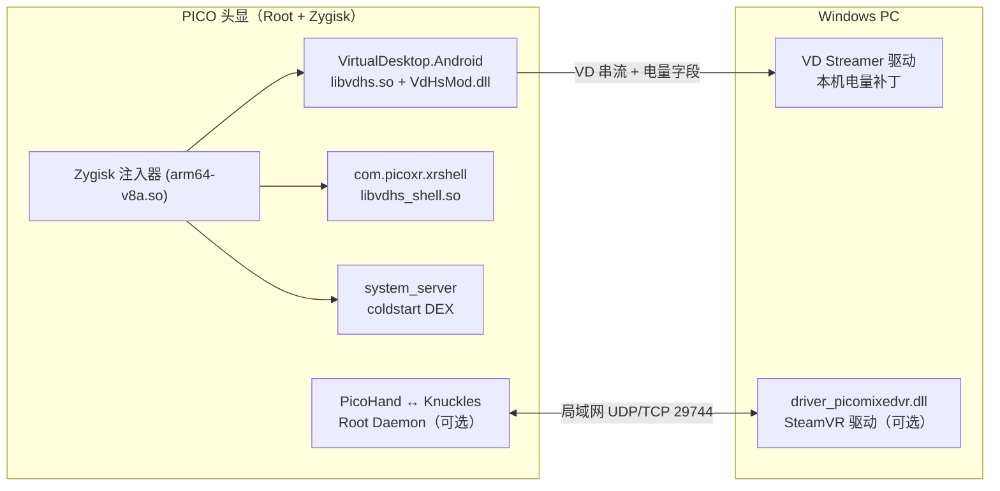

<div align="center">

# VD-PicoEnhance

**为 PICO 4 / PICO 4 Pro 上的原版 Virtual Desktop 提供光学手追、Quest 式手部透视、眼动指针修正、码率与分辨率解锁及 SteamVR 手柄电量显示。**

[](LICENSE)
[](#使用要求)
[](https://github.com/WolalaQAQ/VD-PicoEnhance/releases/latest)

[English](README.md) | **简体中文**

[快速开始](#快速开始) · [功能一览](#功能一览) · [日常使用](#日常使用) · [配置与进阶](#配置与进阶) · [常见问题](#常见问题与已知限制) · [开发者指南](#开发者指南) · [社区](#社区)

</div>

---

VD-PicoEnhance 是一个 Magisk/Zygisk 模块，在运行时为官方原版 `VirtualDesktop.Android` 补齐 PICO 平台的扩展能力，磁盘上的官方 APK 保持原样。

> [!NOTE]
> 已在 **PICO 4 Pro**（PICO OS 5.13.7）上验证 Virtual Desktop **1.34.22.0 / 1.34.25.0**，并由社区确认在 **PICO 4** 上运行正常（[PR #2](https://github.com/WolalaQAQ/VD-PicoEnhance/pull/2#issuecomment-6263664529)）。需要 root 并开启 Zygisk。

## 功能一览

### 手追、手部透视与眼动

- **PICO 光学手追**：向 Virtual Desktop 开放 `XR_EXT_hand_tracking`，在层内合成 `XR_FB_hand_tracking_aim`（捏合、指向射线和掌心菜单手势，runtime 自身 aim 有效时优先使用），并通过内置手部网格（`hand_mesh_fb.bin`）提供 `XR_FB_hand_tracking_mesh`。
- **PICO 手柄 / 手追热切换**：放下 PICO 手柄自动切到手追，拿起手柄切回。
- **Quest 式手部透视**：在 Virtual Desktop 界面内为每只手单独渲染 projected 透视层；在 SteamVR 中直接在 VD 串流画面的 swapchain 上原地开 alpha 孔（零拷贝、不加层），遵循 VD 自身的 `VRPassthroughHands` 开关条件，非 VR 画面不做改动。
- **关节冻结门控**：当 runtime 关节数据长时间不更新时（默认 `300 ms`），将该手标记为不活跃，缓解手部模型“亮一下就卡住或消失”的现象。
- **眼动手势指针修正** *(需要眼追硬件)*：仅对 VD 界面指针启用 One-Euro 平滑、跳变确认和头部姿态补偿；注视点串流与眼动转发保持原始数据透传。

### 码率与分辨率解锁

- **3 倍码率上限**：直接扩展 VD 原生桌面码率和 VR 码率滑块至原上限的约 3 倍，不改动你当前的选值，也不增加多余开关。实测带宽与编解码器限制仍然生效。
- **高分辨率画质档位**：直接开放 VD 原有的 **Monster**（3840×3840）、**Rampage**（4416×4416）和 **Unstoppable**（5184×5184）每眼基准画质档位。

### 实用体验改进

- **SteamVR 显示 PICO 手柄电量**：借助 VD 原有数据字段回传电量，通过本机修补的 PC 端 OpenVR 驱动发布到 SteamVR。
- **中文界面**：自动跟随头显系统语言，中文系统下自动汉化 VD 控制面板与 SteamVR 性能面板，同时保留游戏名、文件路径、时间、实时数值和单位原文。
- **手势模式直接启动 VD**：在 PICO OS 5.13.7 上，向系统内存中的包元数据声明 VD 支持手追，让你在系统手势模式下可以直接打开 VD。
- **系统手势屏蔽** *(实验性，默认关闭)*：在 VD 的 **输入 → 屏蔽系统手势** 提供运行时开关，阻止 VD 聚焦时误触 PICO 的重定位或 Dock 手势。

### 可选模块：PicoHand<->Knuckles 自动切换

如果你在 SteamVR 中同时使用 **Valve Index 指虎（Knuckles）** 和 PICO 光学手追，可以启用可选模块 **PicoHand<->Knuckles** 自动在两者之间切换：

- **拿起指虎**（移动指虎的同时触碰触摸板）→ 关闭 PICO 系统手追与系统手势。
- **放下指虎**（所有在线指虎松开触摸板并保持静止 1 秒）→ 自动恢复 PICO 系统手追。

PC 端只是一个随 SteamVR 启停的轻量驱动（`driver_picomixedvr`），通过局域网（`29744` 端口）与头显上的独立 root daemon 通信，日常使用不需要 ADB、VD 画面数据或额外常驻程序。详见[安装与使用指南](docs/PC-SETUP_zh.md)。

## 使用要求

| 组件 | 要求 |
|---|---|
| 头显 | **PICO 4** 或 **PICO 4 Pro**（`arm64-v8a`）；眼动指针修正需要眼追硬件 |
| Root | Magisk ≥ 27000 并开启 **Zygisk**（API v5），或独立 Zygisk 实现（如 ReZygisk / NeoZygisk） |
| Virtual Desktop（头显） | 官方原版 `VirtualDesktop.Android` **1.34.22.0** 或 **1.34.25.0** |
| PC（安装与日常使用） | Windows x64、Virtual Desktop Streamer **1.34.22.0** 或 **1.34.25.0**、SteamVR、`adb`（Android platform-tools） |
| 手势模式启动与指虎切换 | PICO OS 5.13.7（`Pico/Phoenix/PICOA8110:10/5.13.7/smartcm.1761755159:user/dev-keys`）；指虎切换另需 Valve Index 指虎及同一私有局域网 |

## 快速开始

1. 从 [Releases](https://github.com/WolalaQAQ/VD-PicoEnhance/releases/latest) 下载 `VD-PicoEnhance-v<版本号>.zip`，完整解压到 PC 上的任意目录。
2. 退出 **Virtual Desktop** 和 **SteamVR**，通过 USB 或已授权的无线 ADB 连接头显（确保已在 Magisk 中授予 shell root 权限）。
3. 在运行 SteamVR 的同一 Windows 账户下，于解压目录打开普通 PowerShell 并运行：

```powershell
# 基础安装：VD-PicoEnhance + SteamVR PICO 手柄电量
powershell -NoProfile -ExecutionPolicy Bypass -File .\install-vd-picoenhance.ps1

# 基础安装 + 可选的 PicoHand<->Knuckles 指虎/手追自动切换
powershell -NoProfile -ExecutionPolicy Bypass -File .\install-vd-picoenhance.ps1 -WithKnuckles
```

安装器会就地修补 PC 上的 VD OpenVR 驱动（仅在写入 PC 文件时请求管理员确认）、刷入头显 Magisk 模块、自动放置缺失的手部网格，并重启一次头显。全部文件均来自解压后的整合包，脚本不会联网下载任何内容。

> [!TIP]
> 常用参数：`adb` 不在 `PATH` 时加 `-Adb 'C:\path\to\adb.exe'`；连接多台设备时加 `-Serial <设备>`；非标准 Streamer 路径加 `-DriverPath <驱动 DLL 完整路径>`；手动重启加 `-NoReboot`；自动识别局域网网卡有误时加 `-HeadsetAddress` / `-PcAddress`。详细安装、日常操作和升级说明见 [docs/PC-SETUP_zh.md](docs/PC-SETUP_zh.md)。

头显重启完成后，正常启动 Virtual Desktop 和 SteamVR 即可。升级时使用新版整合包运行同一条命令；已安装 PicoHand<->Knuckles 时会自动随同升级并保留启停状态，无需再传 `-WithKnuckles`。

## 日常使用

### 码率与画质滑块

扩展范围会自动生效于 VD 原有的**设置 → 桌面码率**、**串流 → VR 码率**和**串流 → VR 画质**滑块。原有的低码率与低画质档位仍然可选，模块不会擅自调高你当前的选值。

- **使用手动高码率**：在 PC 端 Virtual Desktop Streamer 中关闭**自动调整码率**（Automatically adjust bitrate），否则 Streamer 仍会自动压低实际码率。建议逐步调高并留意网络与解码延迟。
- **性能面板读数说明**：
  - **最大码率**显示扩展上限与实测带宽中的较小值，代表可选上限，而非实时吞吐。
  - **渲染分辨率 %** 是 PC 上报渲染宽度与**当前所选画质档位**基准宽度（Monster 3840、Rampage 4416、Unstoppable 5184）的比值。相同 PC 渲染宽度下，画质档位越高，百分比显示越低。
- **应用分辨率改动**：切换画质档位后按 VD 提示重启 VR 串流。扩展选值保存在 `/data/data/VirtualDesktop.Android/vdhs/streaming_limits.txt` 中，启动时静默恢复。

### 系统手势屏蔽

在 Virtual Desktop 内勾选 **输入 → 屏蔽系统手势**（英文系统为 **Suppress system gestures**）。开关默认**关闭**，记住你的选择，切换后 1 到 2 秒内生效，无需重启 VD 或头显。取消勾选即可立即恢复 PICO 重定位和 Dock 手势。

### 中文界面

汉化在 VD 启动时读取系统语言并自动切换。更改头显系统语言后，重启 VD 即可生效。

### VD 1.34.25.0 中的自动隐藏手部

Virtual Desktop 1.34.25.0 启用了原生的自动隐藏手部计时器。如果静止时手部自动隐去、希望保持常显，在 VD 的**输入**页关闭**自动隐藏手部**（Automatically hide hands）即可。

## 常见问题与已知限制

- **SteamVR 中用捏合（扳机）切换主手不生效**：手张开时合成扳机值约为 `0.27` 而非 `0`，而 VD 仅在扳机值到达 `1.0` 时触发数字 click。计划后续在托管层加入死区重映射。
- **转头时眼动指针轻微漂移**：快速转动头部时仍可能出现轻微指针偏移。
- **长时间使用后手部闪烁并消失**：OpenXR runtime 或 SteamVR 偶尔会让手部关节长时间冻结，重启 SteamVR 即可恢复。
- **手势模式下启动 VD 仍提示“不支持手势”**：确认头显固件指纹为已支持的 PICO OS 5.13.7，且启动助手处于启用状态（见下方[手势模式启动 CLI](#进阶选项)）。
- **VD Streamer 自动更新后手柄电量消失**：Streamer 更新会覆盖修补过的 PC 驱动。退出 SteamVR，使用适配新版本的整合包重新运行 `install-vd-picoenhance.ps1` 即可。
- **Android VD 版本更新**：兼容层依赖版本相关的内部命名，未适配的新版 VD 可能导致模块暂时失效。
- **待做 — USB 有线串流**：VD 1.34.22+ 支持通过 USB NCM 有线串流，但 PICO 默认未向应用开放这条链路。后续计划在头显侧拉起 USB 网络接口并在真机验证后决定是否纳入正式功能。

## 卸载与回滚

退出 Virtual Desktop 和 SteamVR，通过 ADB 连接头显，在解压目录运行：

```powershell
# 完整卸载（恢复 PC 原版 VD 驱动、移除头显模块及已安装的指虎切换模块）
powershell -NoProfile -ExecutionPolicy Bypass -File .\install-vd-picoenhance.ps1 -Action Uninstall

# 仅卸载 PicoHand<->Knuckles（保留 VD-PicoEnhance 与手柄电量显示）
powershell -NoProfile -ExecutionPolicy Bypass -File .\install-vd-picoenhance.ps1 -Action UninstallKnuckles
```

如果只想暂时停用 **PicoHand<->Knuckles** 而不卸载，运行 `-Action Disable`（用 `-Action Enable` 重新开启）。

如需在 Magisk 中手动停用头显模块，直接在 Magisk 管理器中关闭开关，或以 root 执行 `touch /data/adb/modules/vdhs_zygisk/disable` 后重启。停用或移除模块后，可删除 `/data/data/VirtualDesktop.Android/vdhs/` 清理暂存文件、已保存的开关、`hand_gesture.txt` 和自定义网格。

---

## 配置与进阶

默认使用无需任何配置文件。如需微调运行时参数，从 [`config/hand_gesture.example.txt`](config/hand_gesture.example.txt) 复制需要覆盖的条目到：

```text
/data/data/VirtualDesktop.Android/vdhs/hand_gesture.txt
```

保存后重启 Virtual Desktop 生效。未写出的键沿用内置默认值，升级时保留你的显式配置。

<details>
<summary><strong>运行时配置项（<code>hand_gesture.txt</code>）</strong></summary>

| 键名 | 默认值 | 说明 |
|---|---|---|
| `pt_hole` | `1` | 在 SteamVR 画面上绘制零拷贝手部透视孔（`0` 为关闭） |
| `pt_follow_settings` | `1` | 仅在满足 VD 自身 `VRPassthroughHands` 条件时开孔 |
| `pt_bg_fix` | `1` | 未绘制手部开孔时恢复背景透视状态 |
| `pt_split` | `1` | 在 VD 内为左右手分别创建 projected 层，确保双手同时可见 |
| `pt_disc_r` / `pt_margin_px` / `pt_flip_y` / `pt_max_age_ms` | `0.1` / `0` / `0` / `100` | 透视圆盘半径（米）、额外像素边距、Y 轴翻转、手部数据最大有效期 |
| `hj_freeze_ms` | `300` | 关节静止超过该毫秒数后标记手部不活跃（`0` 为关闭） |
| `gaze_vd_fix` / `gaze_filter` | `1` / `1` | 界面指针的头部姿态补偿与 One-Euro 平滑（串流眼动始终透传） |
| `gaze_beta` / `gaze_mincutoff` / `gaze_jump_deg` / `gaze_hold_ms` | `0.01` / `1.0` / `8` / `120` | One-Euro 滤波参数、注视跳变阈值、无效样本保持时间 |
| `aim_runtime` / `aim_shoulder` / `aim_smooth` / `aim_pitch_deg` | `1` / `1` / `0.2` / `0` | 优先使用 runtime 有效 aim；肩到食指射线、平滑系数、俯仰偏移 |
| `pinch_on_cm` / `pinch_off_cm` / `pinch_full_cm` | `0.4` / `0.8` / `3.0` | 指尖间距阈值（须满足 `0 <= on < off <= full`），非法组合会回退默认值 |
| `menu_pinch_cm` / `menu_hold_ms` / `menu_cooldown_ms` | `0.6` / `500` / `300` | 掌心菜单手势捏合距离、按住时长和冷却时间 |
| `gaze_log` / `pt_alpha_only` / `pt_style` | `0` | 诊断调试开关，日常保持 `0` |

</details>

### 进阶选项

<details>
<summary><strong>手势模式启动 CLI（<code>coldstart.sh</code>）</strong></summary>

以 root 在头显上查询或开关 `system_server` 包元数据助手：

```sh
sh /data/adb/modules/vdhs_zygisk/coldstart.sh status   # 正常应显示 applied 或 native、int1、ok
sh /data/adb/modules/vdhs_zygisk/coldstart.sh query    # 正常应显示 metadata-query int1 ok
sh /data/adb/modules/vdhs_zygisk/coldstart.sh disable  # 恢复原有元数据并保存停用选择
sh /data/adb/modules/vdhs_zygisk/coldstart.sh enable   # 重新启用
```

升级模块时会保留你保存的启停选择。

</details>

<details>
<summary><strong>自定义或关闭中文界面（<code>ui_zh.txt</code>）</strong></summary>

以 root 编辑 `/data/adb/modules/vdhs_zygisk/payload/ui_zh.txt` 后重启 VD。每行格式为 `英文<TAB>中文`，字面量 `\n` 表示换行。删除该文件并重启 VD 即可关闭汉化。

</details>

<details>
<summary><strong>替换或自行生成手部网格（<code>hand_mesh_fb.bin</code>）</strong></summary>

模块首次启动 VD 时会自动把内置的 `hand_mesh_fb.bin` 安装到 `/data/data/VirtualDesktop.Android/vdhs/hand_mesh_fb.bin`，并保留已有网格文件。

- 通过安装器替换：运行 `install-vd-picoenhance.ps1` 时传入 `-MeshPath <文件路径>`。
- 从自己头显的 `XRShell.apk` 离线生成（需要 Python 3 和 NumPy）：

```sh
python tools/mesh/xrshell_mesh.py blob --apk /path/to/XRShell.apk --out out
```

手动推送步骤、SHA-256 校验和来源声明见 [`assets/mesh/README_zh.md`](assets/mesh/README_zh.md)。

</details>

<details>
<summary><strong>仅安装头显与注入对照测试（<code>mode.txt</code>）</strong></summary>

- **仅安装头显**：给 `install-vd-picoenhance.ps1` 加上 `-HeadsetOnly`，或在 Magisk 管理器中选择 **模块 → 从本地安装** 刷入 `vdhs_zygisk.zip` 并重启。此方式不配置 PC 手柄电量显示和 PicoHand<->Knuckles。
- **注入对照模式（`Mode 1`）**：安装时传入 `-Mode 1`，或以 root 将 `/data/adb/modules/vdhs_zygisk/payload/mode.txt` 改为 `1` 并重启。模式 `1` 仅验证 Zygisk 注入与 Mono 可达性，不启动兼容层、Shell 接收端和启动助手；改回 `2` 并重启即可恢复完整模式。

</details>

## 开发者指南

### 工作原理



在 `VirtualDesktop.Android` 进程内，`libvdhs.so` 通过 ShadowHook 在 VD 自带 `libopenxr_loader.so` 的内存导出符号上安装 inline hook，直达 PICO runtime（`xrMarkApiClass`），完成 FB aim/mesh 合成、零拷贝手部透视开孔、界面专属眼动滤波和手柄电量写入。托管层 `VdHsMod.dll` 全程使用反射，对 VD / Xenko 程序集零编译期依赖，负责扩展列表注入、码率与画质滑块解锁、界面汉化以及手势屏蔽开关。

组件划分、hook 列表和协议细节见 [`docs/ARCHITECTURE_zh.md`](docs/ARCHITECTURE_zh.md) 与 [`mod/README_zh.md`](mod/README_zh.md)。

### 目录结构

| 路径 | 内容 |
|---|---|
| `mod/native/` | VD 载荷（`libvdhs.so`）、Shell 接收端（`libvdhs_shell.so`）、能力策略、符号解析器及内置 ShadowHook 2.0.1 |
| `mod/src/VdHsMod/` | 托管 mod（`netstandard2.0`，纯反射，默认可离线构建） |
| `zygisk/` | Magisk/Zygisk 模块：注入器（`jni/`）、`payload/` 配置与汉化词典、模块脚本、`build.ps1` |
| `coldstart/` | VD 专属 `system_server` 包元数据助手与构建脚本 |
| `pc/driver/` | 独立 x64 电量代码载荷、PE 修补工具（`NativePatch.cs`）及本机安装 / 恢复脚本 |
| `knuckles/` | 可选 PicoHand<->Knuckles：SteamVR 驱动（`pc/`）、输入采集（`capture/`）、头显 daemon（`headset/`）与 `build.ps1` |
| `tools/` | 统一安装器（`install-vd-picoenhance.ps1`）、打包脚本、`mesh/xrshell_mesh.py` 及测试套件（`checks/`） |
| `assets/mesh/` | Release 附带的 `hand_mesh_fb.bin`、哈希、来源说明与免责声明 |
| `config/` | `hand_gesture.example.txt` 与 `vd-capability.example.txt` 示例配置 |
| `docs/` | [安装与使用指南](docs/PC-SETUP_zh.md)与[架构文档](docs/ARCHITECTURE_zh.md) |

### 从源码构建

**构建环境（Windows x64）：** PowerShell（`pwsh`）、.NET SDK、JDK 17（设置 `JAVA_HOME` 或写入不跟踪的 `tools/jdk-path.txt`），以及 Android SDK（设置 `ANDROID_SDK_ROOT` / `ANDROID_HOME` 或写入 `tools/sdk-path.txt`），包含 **NDK 26.1.10909125**、**CMake 3.22.1**、**Android Platform 35** 和 **Build-Tools 35.0.0**。构建 PicoHand<->Knuckles 另需 **Python 3** 与 **Zig 0.13.0**。

```powershell
# 1. 构建原生载荷、托管 mod、启动助手并打包 Magisk 模块（zygisk/dist/vdhs_zygisk.zip）
pwsh -File zygisk/build.ps1 -Pack

# 2. 构建 PC 电量载荷（首次下载固定版本的 OpenVR 2.12.14 头文件；离线可用 -OpenVRHeader <文件>）
pwsh -File pc/driver/build.ps1

# 3. 构建可选的 PicoHand<->Knuckles（按需传 -Zig / -Python / -SdkRoot / -OpenVRRoot）
pwsh -File knuckles/build.ps1

# 4. 组装完整 Release 整合包（VD-PicoEnhance-v<版本号>.zip 与 SHA256SUMS.txt）
pwsh -File tools/pack-release.ps1
```

原生载荷要求零警告通过，默认 `VdHsMod` 构建不还原 NuGet 包。构建和打包过程均不需要也不包含任何 Virtual Desktop 原版 DLL。

## 安全与隐私

- **Root 与运行时注入**：模块需要 root，会向 `VirtualDesktop.Android`、`com.picoxr.xrshell`（手势接收端）以及 PICO OS 5.13.7 的 `system_server`（仅处理 VD 元数据）注入代码。请只在自己的设备上安装自行构建或信任的版本。Shell 接收端与启动助手均不注入 OpenXR runtime 服务，也不修改全局手追开关。
- **原版 APK 与本机补丁**：官方 Android APK、清单和签名保持原样。PC 电量补丁在你的电脑上就地修补 `driver_VirtualDesktop.dll`，并在同目录保留精确原件备份。
- **局域网配对密钥（PicoHand<->Knuckles）**：发现与控制通过局域网 TCP/UDP `29744` 端口明文携带配对密钥。请在可信的家庭局域网内使用，切勿将 `29744` 端口映射到公网。Windows 上的凭据文件仅当前用户和 `SYSTEM` 可读。
- **干净仓库**：除 Release 整合包附带的手部网格 blob 外（见 [`THIRD_PARTY_NOTICES.md`](THIRD_PARTY_NOTICES.md)），本仓库不包含任何 Virtual Desktop、Xenko、Mono 或 PICO 二进制与源码。
- **反馈问题**：提交 Issue 时请附带头显型号、PICO OS 版本、Virtual Desktop 版本和脱敏后的日志片段，勿上传设备序列号或密钥。

## Pico-Enhance 生态

| 项目 | 说明 |
|---|---|
| **[VD-PicoEnhance](https://github.com/WolalaQAQ/VD-PicoEnhance)** | Virtual Desktop 手追、手部透视、眼动修正、码率/分辨率解锁、手柄电量与指虎切换 *(本仓库)* |
| **[PicoET-Enhance](https://github.com/WolalaQAQ/PicoET-Enhance)** | PICO 4 Pro 真实瞳孔、左右眼独立表情、90/90 Hz 追踪、头显端后处理调节与局域网相机广播 |
| **[PicoFacialBridge](https://github.com/WolalaQAQ/PicoFacialBridge)** | PICO 头显到 PC 的眼追与面捕数据桥接 |
| **[UnifiedPicoModule](https://github.com/WolalaQAQ/UnifiedPicoModule)** | 面向 VRCFaceTracking 的 PICO 眼追 / 面捕 PC 接收模块 |
| **[VRCFT-Enhance](https://github.com/WolalaQAQ/VRCFT-Enhance)** | VRCFaceTracking 延迟与更新率优化补丁 |
| **[PicoRegionSwitch](https://github.com/WolalaQAQ/PicoRegionSwitch)** | 面向 PICO OS 系统应用的双区安全 Magisk 切区工具 |
| **[PicoUSB-Quiet](https://github.com/WolalaQAQ/PicoUSB-Quiet)** | 抑制 PICO 头显反复弹出的 USB 权限确认框 |

## 社区

使用求助、交流和版本更新通知，欢迎加入 Pico-Enhance 社区。

<a href="https://discord.gg/ueSEydeVD8"></a>

**QQ 群：** 1129699813，用 QQ 扫描下方二维码即可加入。


## 致谢

- [misaka18848](https://github.com/misaka18848)：为普通 PICO 4 完成兼容适配（[PR #1](https://github.com/WolalaQAQ/VD-PicoEnhance/pull/1)）、运行时手势屏蔽开关与中文汉化（[PR #2](https://github.com/WolalaQAQ/VD-PicoEnhance/pull/2)），并在 PICO 4 真机上验证整合版本。
- [ShadowHook](https://github.com/bytedance/android-inline-hook)：inline hook 运行时。
- [VDExtra](https://github.com/git-morin/io.github.git_morin.vdextra) 与 [VirtualDesktop-Unlock](https://github.com/ShadowManXR/VirtualDesktop-Unlock)：码率扩展方案参考；本项目复用 VD 原生滑块和设置同步实现。
- John "topjohnwu" Wu：Magisk / Zygisk 模块 API。
- `hand_mesh_fb.bin` 基于 PICO 系统手部网格，通过 `tools/mesh/` 中的离线工具转换生成。

## 免责声明与许可证

这是非官方社区互操作项目，与 Virtual Desktop 和 PICO 无关，也不包含或绕过任何授权。“Virtual Desktop”与“PICO”商标归各自所有方所有。

本项目采用 [MIT](LICENSE) 许可证。第三方组件保留各自许可证，见 [`THIRD_PARTY_NOTICES.md`](THIRD_PARTY_NOTICES.md)。各版本更新记录见 [`CHANGELOG_zh.md`](CHANGELOG_zh.md)。
