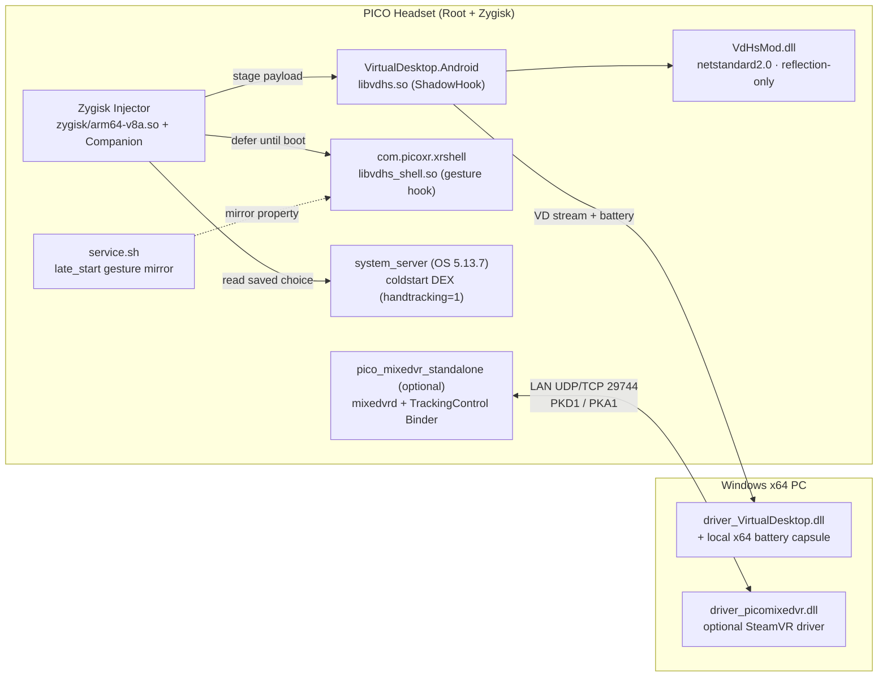
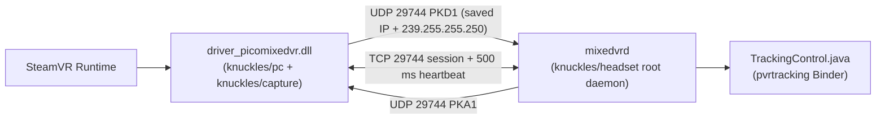

# Architecture

**English** | [简体中文](ARCHITECTURE_zh.md)

VD-PicoEnhance adds PICO optical hand tracking, Quest-style hand passthrough, eye-gaze pointer fixes, unlocked bitrate/resolution ranges, Chinese localization, and SteamVR controller battery reporting to the **unmodified** official Virtual Desktop (`VirtualDesktop.Android`) app. The APK is never patched, repacked, re-signed, or renamed.

This document describes the current Zygisk architecture for developers reading or extending the codebase. End-user installation and daily use are covered in [`README.md`](../README.md) and [`PC-SETUP.md`](PC-SETUP.md).

## 1. System Overview

### 1.1 Zygisk Injector (`zygisk/jni/module.cpp`)

The injector is written in C/C++ with no C++ STL (`APP_STL=none`). It matches `VirtualDesktop.Android`, `com.picoxr.xrshell` (full mode `2` only), and `system_server` (for the startup capability helper):

- **Staging**: Opens payload file descriptors in `preAppSpecialize`, exempts them via `api->exemptFd()` when `args->fds_to_ignore` is non-null (skipping `exemptFd()` for Android USAP launches where `fds_to_ignore` is null and standalone Zygisk implementations such as ReZygisk/NeoZygisk reject it), copies files atomically into `<app_data>/vdhs/`, and preserves any existing `hand_mesh_fb.bin`.
- **Linker namespace fallback**: Calls `dlopen()` on the staged `.so`. If standalone Zygisk hides the module library from the linker `soinfo` list and plain `dlopen()` is blocked by the anonymous namespace, `open_payload_library()` retries through bionic's `__loader_dlopen` using a default-namespace caller (`__android_log_print` from `liblog.so`), keeping `dladdr()` paths and xDL symbol resolution intact.
- **Native symbol resolution (`mod/native/vdhs_sym.c`)**: Both `libvdhs.so` and `libvdhs_shell.so` resolve symbols through a thin adapter over vendored xDL (`mod/native/third_party/shadowhook-2.0.1/`). Each lookup batch targets one already-mapped library, never force-loads unrelated objects, and never caches handles across runtime reloads.

### 1.2 PICO Shell Gesture Receiver (`libvdhs_shell.so`)

In full mode (`2`), the injector holds only the payload descriptor when `com.picoxr.xrshell` specializes, then spawns a detached worker that waits for `sys.boot_completed=1` before staging and hooking `libvdhs_shell.so`.

- Virtual Desktop's **Input → Suppress system gestures** checkbox is the sole control. It writes `0` or `1` to `<app_data>/vdhs/system_gestures.txt`.
- After `sys.boot_completed=1`, `zygisk/service.sh` polls that file once per second and writes the system property `vdhs.system_gestures` only when the value changes.
- Before hooking, `libvdhs_shell.so` verifies its private `libc++` layout against the Shell's streaming-app entry. When focused on `VirtualDesktop.Android` and `vdhs.system_gestures` equals `1`, it applies PICO's streaming-app gesture-suppression rule. Missing or invalid values evaluate to off, other packages stay on their original path, and the OpenXR runtime service is never injected.

### 1.3 VD-Only System Launch Capability (`coldstart/`)

`coldstart/java/org/vdpico/capability/` allows PICO's launcher to start Virtual Desktop while the headset is already in system hand mode:

- During `preServerSpecialize`, the injector verifies full mode and queries the root Zygisk companion for the saved choice (`missing`, `off`, `on`, or `error`), avoiding direct traversal of root-private directories inside `system_server`.
- The server boot thread launches a native worker and returns immediately. After `sys.boot_completed=1`, the worker attaches to the VM and loads the helper DEX via `InMemoryDexClassLoader`. No VD, OpenXR, or Mono payload is loaded into `system_server`.
- Restricted strictly to Android 10 (API 29) and exact fingerprint `Pico/Phoenix/PICOA8110:10/5.13.7/smartcm.1761755159:user/dev-keys`.
- Copies VD's in-memory `PackageManagerService` metadata `Bundle`, adds integer `handtracking=1`, and confirms readback through `PackageManager`. Disabling restores the original key/type without clobbering unrelated keys; VD package replacements establish a fresh baseline.
- Managed via a root-only local socket (`vdhs.vd-capability`) and `zygisk/coldstart.sh` (`status`, `query`, `enable`, `disable`). Does not alter global hand-tracking settings.

### 1.4 Runtime Capability Gating (`mod/native/vdhs_caps.c`)

`vdhs_caps.c` separates the firmware property `ro.pxr.eyetracking.support` from the OpenXR runtime's confirmed `XR_EXT_eye_gaze_interaction` support:

- Eye-gaze pointer filtering and compensation activate only when the OpenXR runtime confirms eye-gaze support—not via a model whitelist.
- An explicit hardware `0` disables the legacy PICO face-permission alias; an absent property keeps it without advertising or creating a face tracker.
- Hand tracking and hand passthrough are completely independent of eye/face capability gates.

## 2. OpenXR Compatibility Layer (`mod/native/`)

Virtual Desktop ships its own Khronos OpenXR loader (`libopenxr_loader.so`). `libvdhs.so` installs **ShadowHook inline hooks** on that loader's in-memory exports, leaving the APK and system libraries untouched on disk:

| Loader Export | Hook Responsibility |
|---|---|
| `xrEnumerateInstanceExtensionProperties` | On first call, loads the PICO runtime and invokes `xrMarkApiClass` (`vdhs_mark.c`). |
| `xrCreateInstance` | Fallback mark call, appends the PICO controller extension, strips layer-only extensions before forwarding. |
| `xrGetInstanceProcAddr` | Returns wrapper entry points for `XR_EXT_hand_tracking` and `XR_FB_hand_tracking_*` functions. |
| `xrCreateAction` / `xrGetActionStatePose` | Tracks `grip_pose` and reports the controller pose inactive while PICO's active input is optical hands. |
| `xrGetSystemProperties` | Records hand-tracking and eye-gaze support flags for capability gating. |
| `xrEndFrame` / `xrPollEvent` | Per-hand projected layer splitting, background passthrough restoration, and permission/event handling. |
| `xrCreateActionSpace` / `xrLocateSpace` | Eye-gaze consumer routing, pointer-only One-Euro smoothing, and head-pose compensation. |
| `xrReleaseSwapchainImage` *(and swapchain helpers in `vdhs_pt.c`)* | In-place, zero-copy alpha hole drawing for SteamVR hand passthrough. |
| `xrSuggestInteractionProfileBindings` / `xrSyncActions` *(optional, `vdhs_battery.c`)* | Appends left/right controller battery float actions and samples readings after sync. |

### 2.1 Enabling PICO Hand Tracking

PICO's OpenXR runtime only advertises `XR_PICO_hand_tracking` and related extensions after a vendor loader calls `xrMarkApiClass(mask)`. VD's bundled loader never makes that call. `vdhs_mark.c` reaches the active runtime listed in `/vendor/etc/openxr/1/active_runtime.json` and calls `xrMarkApiClass(0x3b)` before extension enumeration. `vdhs_hand.c` then adds the hand-tracking extensions to VD's managed `XR._supportedExtensions` set (and updates VD's enum cache, allocating PICO extension IDs after stock enum values) after VD's PICO whitelist filter runs.

### 2.2 Aim, Pinch & Menu Synthesis (`vdhs_hand.c`)

When `xrLocateHandJointsEXT` is called, FB structs are unlinked before invoking the PICO runtime and populated afterward:

- `XrHandTrackingScaleFB` is populated with scale `1.0`.
- `XrHandTrackingAimStateFB` prefers a valid runtime aim pose when available (`aim_runtime=1`); otherwise it synthesizes pinch state/strength (hysteresis thresholds `pinch_on_cm` / `pinch_off_cm` / `pinch_full_cm`), a shoulder→index-proximal pointing ray, and a palm-toward-headset menu gesture.
- A joint freeze gate (`hj_freeze_ms`, default `300 ms`) marks a hand inactive when joint poses stop updating.

### 2.3 Hand Mesh (`xrGetHandMeshFB`)

`xrGetHandMeshFB` serves geometry directly from `/data/data/VirtualDesktop.Android/vdhs/hand_mesh_fb.bin`, a CRC32-validated `VDHM` binary container with 16-byte aligned arrays matching OpenXR `XrHandTrackingMeshFB` memory layout. If no valid blob is present, `XR_FB_hand_tracking_mesh` is not advertised. See [`assets/mesh/README.md`](../assets/mesh/README.md) and `tools/mesh/xrshell_mesh.py`.

### 2.4 Zero-Copy Hand Passthrough (`vdhs_pt.c`)

- **Inside Virtual Desktop**: Splits left and right hands into separate projected layers (PICO retains one geometry per layer) and restores background passthrough state when no hole is drawn.
- **Inside SteamVR**: Adds no extra layer and performs no texture copy. Inside `xrReleaseSwapchainImage`, before VD's VR projection texture reaches the compositor, it clears alpha to `0` and masks RGB inside a scissor-bounded disc per hand matching VD's Quest passthrough window. Drawing runs only when VD's own `PassthroughPortals` conditions (`VRPassthroughHands` enabled, VR stream active, hands as current input) are satisfied.

## 3. Eye-Gaze Routing & Filtering

Virtual Desktop shares a single OpenXR gaze-space lookup between its world-space UI pointer and its head-relative streaming/foveated eye-tracking pipeline. Before mutating any sample, the layer inspects the immediate managed caller using Mono's no-IL stack walker:

| Immediate Managed Caller | Route |
|---|---|
| `Session.TryGetEyeGazePose` via `OpenXRHMD.Update` | **UI Pointer**: applies One-Euro smoothing, jump confirmation, invalid-sample hold (`gaze_filter`), and head-pose pre-compensation (`gaze_vd_fix`). |
| `OpenXRHMD.GetEyeState` | **Streaming / Forwarding**: immediate pass-through with original upstream pose and validity flags intact. |
| Unknown caller or unavailable metadata | **Fail-safe**: immediate pass-through. |

Key implementation invariants:
- The stack walker runs inside a balanced Mono GC-unsafe region and restores the incoming thread state afterward (preventing deadlocks on P/Invoke threads that are attached in GC-safe state). If either transition API is missing, classification returns unknown without walking.
- Routing never relies on thread ID or OpenXR space handles, because tracking forwarding can call `GetEyeState` on the render thread.
- Filter history and diagnostic state are thread-local so streaming queries cannot advance pointer filter state, and streaming skips extra head/space queries even when `gaze_log=1`.

## 4. Controller Battery & PicoHand<->Knuckles

### 4.1 Controller Battery Path

1. **Headset (`vdhs_battery.c` + `vdhs_hand.c`)**: Adds left/right float battery input actions to VD's controller action set. If the runtime rejects the binding, VD's stock bindings stay intact. Readings are cached for 1 second. Inside a balanced GC-unsafe region, a native Mono helper resolves `Game._frameData.DeviceState` battery offsets from metadata and writes only those two signed bytes—never caching movable object pointers or replacing pose frames. Unavailable readings remain unavailable rather than reporting `0%`.
2. **PC Capsule (`pc/driver/`)**: `pc/driver/build.ps1` compiles a freestanding x64 PE capsule (`vd-picoenhance.pe`) containing only project code. At install time, `NativePatch.cs` verifies the SHA-256 hash of the user's official `driver_VirtualDesktop.dll` (supporting both 1.34.22.0 and 1.34.25.0), appends RX code and RW state sections, merges unwind/relocation tables locally, and hooks a single provider slot (`RunFrame`) to publish SteamVR battery properties on VD's existing controller containers. No Virtual Desktop DLL is distributed; an exact backup and receipt remain beside the patched DLL.

### 4.2 PicoHand<->Knuckles (`knuckles/`)

PicoHand<->Knuckles is an optional, standalone system that has no hooks inside Virtual Desktop and requires no ADB during runtime.

- **PC Driver (`knuckles/pc/`, `knuckles/capture/`)**: A regular SteamVR driver (`driver_picomixedvr.dll`) with no virtual device. Captures real Lighthouse Index controller trackpad touch via public `DriverInput003`/`004`/`005` Boolean Create/Update interfaces (deduplicating shared tables) alongside device pose.
- **Switching Policy**:
  - *Pickup*: Trackpad touch and valid motion must originate from the **same** Index controller.
  - *Putdown*: Every online Index controller must be explicitly released (touch state observed at least once) and stationary for `1000 ms`.
  - *Fail-safe*: Controllers with unknown touch state or lost tracking never count as released; losing all controllers, stopping, or exiting SteamVR restores the original hand-tracking state and returns to standby. With no Index controllers present, the driver polls status only and writes no system preference.
- **Headset Daemon (`knuckles/headset/`)**: Installed as a separate Magisk module (`pico_mixedvr_standalone`), restricted to the verified PICO OS 5.13.7 fingerprint. Persists the original tracking baseline in a recovery journal before modifying `pvrtracking` via `TrackingControl.java`, and automatically restores the baseline on explicit restore, disconnect, address change, or expiry of the `3000 ms` control lease (maintained by a ~`500 ms` heartbeat).
- **Discovery & Reconnection**: The PC sends a 102-byte `PKD1` UDP frame containing the 64-byte plaintext pairing key and a fresh 32-hex nonce to the saved IP and `239.255.255.250:29744` on active private Ethernet/Wi-Fi adapters. A matching `PKA1` reply echoing key and nonce establishes the current headset IP and grants a 5-second TCP accept window for a same-subnet PC when idle. The daemon binds explicitly to `wlan0` and the multicast group (never `0.0.0.0`), monitors `wlan0` every second, and restores hand tracking before rebinding on IP changes. Transient network failures retry after a ~2-second backoff; explicit stop/disable states, helper errors, protocol errors, and unfinished restores do not auto-retry.

## 5. Managed Mod (`mod/src/VdHsMod/`)

`VdHsMod.dll` targets `netstandard2.0` and holds **zero compile-time references** to Virtual Desktop, Xenko, or `Mono.Android`. Everything is resolved by name via reflection.

### 5.1 Backends (`payload/backend.txt` / `VDHS_BACKEND`)

| Backend | Behavior | Status |
|---|---|---|
| `auto` *(default)* | Uses `redirect` if `Xenko.OpenXR.patched.dll` is staged, else `dataonly`. | Default |
| `redirect` | Preloads a locally built, MVID-bumped `Xenko.OpenXR.patched.dll` so Mono JITs it instead of matching the APK's AOT image. | Experimental, user-built |
| `dataonly` | Reflection-only extension injection without modifying `IsControllerActive`. | Default without redirect DLL |
| `none` | Skips backend changes; native layer and managed UI features still run in full mode. | Diagnostic (use `mode.txt=1` for smoke test) |

### 5.2 UI Switch & Localization

- **`GestureToggle`**: Creates the **Suppress system gestures** checkbox in VD's Input tab at runtime and saves its state to `<app_data>/vdhs/system_gestures.txt`.
- **`UiLocalize`**: Reads `InstalledUICulture` at startup and loads `ui_zh.txt` only on Chinese system locales. Binds cached control-panel pages, templates, and the SteamVR performance overlay while preserving original fonts, user data, device names, and live telemetry. Synchronous UI-thread updates translate inline; background updates dispatch to the UI thread and avoid redundant redraws when text and font are unchanged.

### 5.3 Streaming Limits (`StreamingLimits.cs`)

`StreamingLimits` widens VD's existing Desktop bitrate, VR bitrate, and VR Quality sliders inside `GestureToggle`'s UI dispatch loop with no extra worker thread, native hook, or PC helper:

- **Bitrate formula**: VD's shared bitrate interpolation is unclamped. Raising each slider's `Maximum` to `(3 * stockMax - stockMin) / (stockMax - stockMin)` lets both ends interpret the same normalized value while preserving VD's serializer, measured bandwidth cap, and Streamer auto-bitrate logic.
- **Performance overlay max bitrate**: A retained `TextChanged` listener corrects only the maximum-bitrate label from `min(stockMax, MeasuredBandwidth)` to `min(3 * stockMax, MeasuredBandwidth)`, refreshed on bandwidth, codec, and foveation events.
- **Resolution tiers**: Exposes all entries of VD's existing `VRGraphicsQuality` enum (including Monster, Rampage, Unstoppable) using the headset's native resolution table. Extended selections are persisted to `<app_data>/vdhs/streaming_limits.txt` on UI tick / disposal and restored silently after VD's tab constructors clamp widget bounds.

## 6. Initialization, Failure Handling & Scope

- **Non-blocking startup**: `libvdhs.so` spawns a detached worker to wait for Mono and call `VdHsMod.Loader.Start()` rather than blocking `postAppSpecialize`. Managed exceptions are caught and logged.
- **All-or-nothing hooks**: Required loader hooks activate atomically only after every hook succeeds; any failure rolls back installed hooks and leaves callbacks pass-through. Optional swapchain passthrough hooks use the same all-or-nothing gate.
- **Runtime files**:
  - `/data/adb/modules/vdhs_zygisk/payload/mode.txt`: `2` (full layer, default) or `1` (injection-only smoke test; reboot required when switching).
  - `/data/adb/modules/vdhs_zygisk/payload/backend.txt`: Managed backend selector.
  - `/data/data/VirtualDesktop.Android/vdhs/hand_gesture.txt`: Optional runtime tuning overrides (never rewritten by the module).
- **Verified scope**: PICO 4 and PICO 4 Pro (`arm64-v8a`), unmodified Virtual Desktop Android and Streamer **1.34.22.0 / 1.34.25.0**, Magisk/Zygisk API v5 (including ReZygisk / NeoZygisk). Internal reflection and symbol layouts are version-specific and may require adaptation for newer Virtual Desktop releases.
