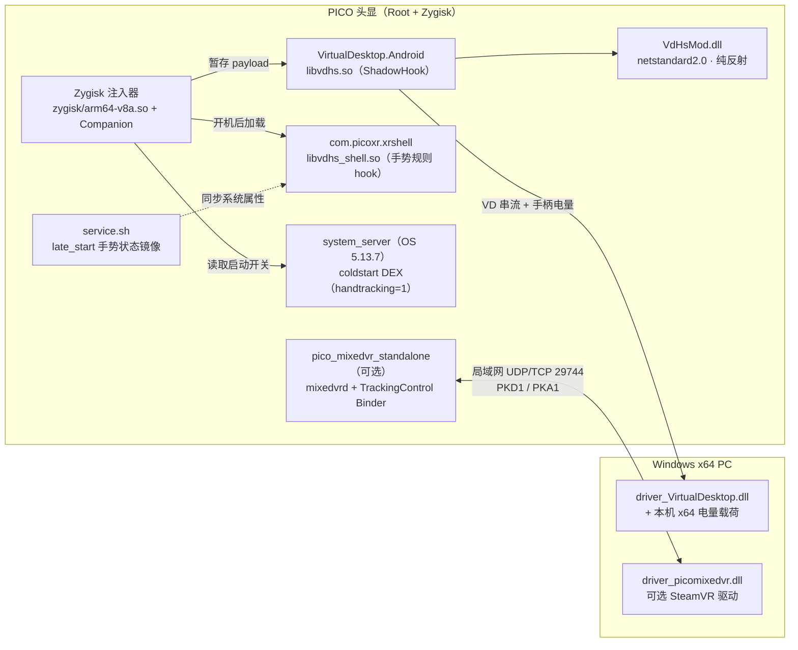
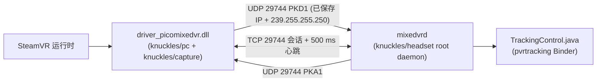

# 架构说明

[English](ARCHITECTURE.md) | **简体中文**

VD-PicoEnhance 在运行时为**未经修改**的官方 Virtual Desktop（`VirtualDesktop.Android`）提供 PICO 光学手追、Quest 式手部透视、眼动指针修正、码率与分辨率范围解锁、中文汉化以及 SteamVR 手柄电量上报。官方 APK 不会被修补、重打包、重签名或改名。

本文面向希望阅读代码或在此基础上扩展的开发者，介绍当前 Zygisk 路线的组件划分与实现机制。用户安装和日常使用见 [`README_zh.md`](../README_zh.md) 与 [`PC-SETUP_zh.md`](PC-SETUP_zh.md)。

## 1. 系统总览

### 1.1 Zygisk 注入器（`zygisk/jni/module.cpp`）

注入器使用不依赖 C++ STL（`APP_STL=none`）的 C/C++ 编写，匹配 `VirtualDesktop.Android`、`com.picoxr.xrshell`（仅完整模式 `2`）和 `system_server`（用于启动能力助手）：

- **暂存（Staging）**：在 `preAppSpecialize` 阶段打开载荷文件描述符；当 `args->fds_to_ignore` 非空时调用 `api->exemptFd()` 放行（Android USAP 池启动时 `fds_to_ignore` 为空，ReZygisk / NeoZygisk 等独立 Zygisk 实现在此时会拒绝 `exemptFd()`，因此跳过该调用），随后将文件原子复制到 `<app_data>/vdhs/`，并保留用户已有的 `hand_mesh_fb.bin`。
- **链接器命名空间回退**：对暂存后的 `.so` 调用 `dlopen()`。若独立 Zygisk 将模块库从链接器 `soinfo` 列表中隐藏，导致普通 `dlopen()` 因匿名命名空间限制而失败，`open_payload_library()` 会改用 bionic 的 `__loader_dlopen`，以默认命名空间调用方（`liblog.so` 中的 `__android_log_print`）加载载荷，保持 `dladdr()` 路径和 xDL 符号解析正常工作。
- **原生符号解析（`mod/native/vdhs_sym.c`）**：`libvdhs.so` 与 `libvdhs_shell.so` 共用一层封装在内置 xDL（`mod/native/third_party/shadowhook-2.0.1/`）之上的符号适配器。每批符号查找仅针对单个已映射库，不会强制加载无关库，也不跨 runtime 重载缓存句柄。

### 1.2 PICO Shell 手势接收端（`libvdhs_shell.so`）

在完整模式（`2`）下，`com.picoxr.xrshell` 进程特化时注入器仅保留载荷描述符，随后拉起独立后台线程等待 `sys.boot_completed=1`，待系统启动完成后再暂存并安装 `libvdhs_shell.so` 的 hook。

- Virtual Desktop 的**输入 → 屏蔽系统手势**复选框是唯一开关，将 `0` 或 `1` 写入 `<app_data>/vdhs/system_gestures.txt`。
- `sys.boot_completed=1` 之后，`zygisk/service.sh` 每秒轮询该文件，仅在值变化时更新系统属性 `vdhs.system_gestures`。
- 安装 hook 前，`libvdhs_shell.so` 会先核对 Shell 已知串流应用条目的私有 `libc++` 布局。仅当焦点为 `VirtualDesktop.Android` 且 `vdhs.system_gestures` 精确等于 `1` 时，才套用 PICO 自身的串流应用手势禁用规则；缺失或无效值均按关闭处理，其他应用沿用原路径，且绝不向 OpenXR runtime 服务注入代码。

### 1.3 VD 专属系统启动能力（`coldstart/`）

`coldstart/java/org/vdpico/capability/` 让 PICO 启动器在系统处于手势模式时也能直接启动 Virtual Desktop：

- 在 `preServerSpecialize` 阶段，注入器检查完整模式并通过 root Zygisk companion 读取已保存的开关选择（`missing`、`off`、`on` 或 `error`），避免 `system_server` 直接遍历 root 私有目录。
- `system_server` 启动线程只拉起原生工作线程便立刻返回。等待 `sys.boot_completed=1` 后，工作线程附加到虚拟机并通过 `InMemoryDexClassLoader` 加载助手 DEX。`system_server` 内不加载任何 VD、OpenXR 或 Mono 载荷。
- 严格限定在 Android 10（API 29）且完整指纹为 `Pico/Phoenix/PICOA8110:10/5.13.7/smartcm.1761755159:user/dev-keys` 的系统上启用。
- 复制 VD 在 `PackageManagerService` 内存中的元数据 `Bundle`，仅添加整数 `handtracking=1`，再通过常规 `PackageManager` 读取接口确认生效。停用时还原该键的原值与类型，不覆盖其他键的后续修改；VD 更新覆盖安装时会重建基线。
- 通过 root 专属本地套接字（`vdhs.vd-capability`）和 `zygisk/coldstart.sh`（`status`、`query`、`enable`、`disable`）管理，不改动任何全局手追设置。

### 1.4 运行时能力门控（`mod/native/vdhs_caps.c`）

`vdhs_caps.c` 将固件属性 `ro.pxr.eyetracking.support` 与 OpenXR runtime 实际确认的 `XR_EXT_eye_gaze_interaction` 支持结果分开判定：

- 仅当 OpenXR runtime 确认支持眼动时，才启用眼动指针滤波与补偿，而不依赖机型白名单。
- 固件显式报告硬件为 `0` 时关闭旧版 PICO 面捕权限别名；属性缺失时保留该兼容项，但不对外宣告或创建面捕追踪器。
- 手追和手部透视完全独立于眼动 / 面捕能力门控。

## 2. OpenXR 兼容层（`mod/native/`）

Virtual Desktop 自带一份 Khronos OpenXR loader（`libopenxr_loader.so`）。`libvdhs.so` 在该 loader 的内存导出符号上安装 **ShadowHook inline hook**，磁盘上的 APK 和系统库保持原样：

| Loader 导出符号 | Hook 职责 |
|---|---|
| `xrEnumerateInstanceExtensionProperties` | 首次调用时促使 PICO runtime 加载，并调用 `xrMarkApiClass`（`vdhs_mark.c`）。 |
| `xrCreateInstance` | Mark 回退调用；追加 PICO 手柄扩展；转发前剥离仅限本层消费的扩展。 |
| `xrGetInstanceProcAddr` | 返回 `XR_EXT_hand_tracking` 与 `XR_FB_hand_tracking_*` 包装函数表。 |
| `xrCreateAction` / `xrGetActionStatePose` | 跟踪 `grip_pose`，在 PICO 当前活动输入为手部时将手柄姿态报告为不活跃。 |
| `xrGetSystemProperties` | 记录手追与眼动支持标志，供运行时能力门控使用。 |
| `xrEndFrame` / `xrPollEvent` | 左右手 projected 透视层拆分、背景透视恢复及权限 / 事件修正。 |
| `xrCreateActionSpace` / `xrLocateSpace` | 眼动调用方分流、界面指针专属 One-Euro 平滑与头部姿态补偿。 |
| `xrReleaseSwapchainImage` *(及 `vdhs_pt.c` 相关辅助)* | SteamVR 手部透视的原地零拷贝 alpha 开孔绘制。 |
| `xrSuggestInteractionProfileBindings` / `xrSyncActions` *(可选，`vdhs_battery.c`)* | 追加左右手柄浮点电量输入 action，并在同步后采样读数。 |

### 2.1 启用 PICO 手追扩展

PICO 的 OpenXR runtime 只有在厂商 loader 调用 `xrMarkApiClass(mask)` 之后才会对外宣告 `XR_PICO_hand_tracking` 及相关扩展，而 VD 自带的 loader 不会执行这一步。`vdhs_mark.c` 通过 `/vendor/etc/openxr/1/active_runtime.json` 指向的系统前向 loader 直达 runtime，在扩展枚举前调用 `xrMarkApiClass(0x3b)`。由于 VD 在枚举前还会按自身白名单过滤扩展，`vdhs_hand.c` 在白名单过滤之后把手追扩展写入托管集合 `XR._supportedExtensions`（并更新枚举名缓存，将 PICO 扩展值分配在原版枚举之后）。

### 2.2 Aim、捏合与菜单手势合成（`vdhs_hand.c`）

调用 `xrLocateHandJointsEXT` 时，兼容层先从 `next` 链摘下 FB 结构体再调 PICO runtime，返回后再回填：

- 为 `XrHandTrackingScaleFB` 填入缩放值 `1.0`。
- `XrHandTrackingAimStateFB` 在 runtime 自身 aim 有效时优先采用（`aim_runtime=1`）；否则根据关节数据合成捏合状态与强度（滞回阈值 `pinch_on_cm` / `pinch_off_cm` / `pinch_full_cm`）、肩到食指近节的指向射线以及掌心朝向头显的菜单手势。
- 关节冻结门控（`hj_freeze_ms`，默认 `300 ms`）会在关节姿态长时间无变化时将该手标记为不活跃。

### 2.3 手部网格（`xrGetHandMeshFB`）

`xrGetHandMeshFB` 直接从 `/data/data/VirtualDesktop.Android/vdhs/hand_mesh_fb.bin` 提供网格数据。该文件是带 CRC32 校验、数组按 16 字节对齐的 `VDHM` 二进制容器，内存布局与 OpenXR `XrHandTrackingMeshFB` 成员一致。未检测到有效网格文件时，不向 VD 宣告 `XR_FB_hand_tracking_mesh`。详见 [`assets/mesh/README_zh.md`](../assets/mesh/README_zh.md) 与 `tools/mesh/xrshell_mesh.py`。

### 2.4 零拷贝手部透视（`vdhs_pt.c`）

- **Virtual Desktop 界面内**：左右手拆分为两个独立 projected 透视层（PICO 每层只保留一个几何体），未绘制手部开孔时恢复背景透视状态。
- **SteamVR 串流中**：不增加额外合成层，也不拷贝纹理。在 `xrReleaseSwapchainImage` 阶段、VD 的 VR 投影纹理提交给合成器之前，按每只手的裁剪范围原地将圆盘内 alpha 清零并遮罩 RGB。开孔窗口跟随 VD 自身的 Quest 透视逻辑，仅在满足 `PassthroughPortals` 条件（VR 串流源、`VRPassthroughHands` 开启、当前输入为手）时执行。

## 3. 眼动分流与滤波

Virtual Desktop 的世界空间界面指针与头部相对的注视点串流 / 眼动转发共用同一条 OpenXR gaze 空间查询路径。在修改任何样本之前，兼容层通过 Mono 的无 IL 栈遍历器识别直接托管调用方：

| 直接托管调用方 | 处理路径 |
|---|---|
| `OpenXRHMD.Update` 调用的 `Session.TryGetEyeGazePose` | **界面指针**：启用 One-Euro 平滑、跳变确认、无效样本保持（`gaze_filter`）和头部姿态预补偿（`gaze_vd_fix`）。 |
| `OpenXRHMD.GetEyeState` | **注视点串流 / 转发**：直接透传上游原始姿态与有效标志。 |
| 未知调用方或元数据不可用 | **安全回退**：直接透传。 |

核心实现约束：
- 栈遍历器与元数据回调在成对平衡的 Mono GC-unsafe 区域内执行，结束后恢复线程原状态（防止处于 GC-safe 状态的 P/Invoke 线程在冷路径 AOT 栈查询时发生协作锁死锁）。若状态切换 API 不可用，则不遍历栈，直接按未知调用方透传。
- 分流不依赖线程 ID 或 OpenXR 空间句柄，因为眼动转发也可能在渲染线程上调用 `GetEyeState`。
- 滤波历史和诊断状态均保存在线程局部存储中，串流查询不会推进指针滤波状态；即便开启 `gaze_log=1`，串流路径也会跳过额外的头部 / 空间查询。

## 4. 手柄电量与 PicoHand<->Knuckles

### 4.1 手柄电量链路

1. **头显侧（`vdhs_battery.c` + `vdhs_hand.c`）**：在 VD 现有手柄 action set 中追加左右手浮点电量输入 action；若 runtime 拒绝绑定，VD 原有按键绑定不受影响。读数缓存 1 秒。在平衡的 GC-unsafe 区域内，原生 Mono 助手通过元数据解析 `Game._frameData.DeviceState` 电量字段偏移，仅写入两个有符号字节，不缓存可移动托管对象指针，也不替换正在并发更新的姿态帧。读数不可用时保持“不可用”而非上报 `0%`。
2. **PC 端独立载荷（`pc/driver/`）**：`pc/driver/build.ps1` 编译仅含本项目代码的独立 x64 PE 载荷（`vd-picoenhance.pe`）。安装时 `NativePatch.cs` 校验用户本机官方 `driver_VirtualDesktop.dll` 的 SHA-256（同时支持 1.34.22.0 与 1.34.25.0），在本地追加 RX 代码节与 RW 状态节、合并 unwind / 重定位表，并仅挂接 `RunFrame` 槽位，在 VD 现有物理手柄容器上发布 SteamVR 电量属性。不分发任何 Virtual Desktop DLL，同目录保留精确原件备份和安装记录。

### 4.2 PicoHand<->Knuckles（`knuckles/`）

PicoHand<->Knuckles 是独立的可选模块，不向 Virtual Desktop 注入 hook，日常运行也不需要 ADB。

- **PC 驱动（`knuckles/pc/`、`knuckles/capture/`）**：普通 SteamVR 驱动（`driver_picomixedvr.dll`），不创建虚拟设备。通过公开的 `DriverInput003` / `004` / `005` 布尔输入 Create / Update 接口（对共享虚表去重）采集真实 Lighthouse Index 指虎的触摸板触碰状态与同一设备的姿态。
- **切换策略**：
  - **拿起**：触摸板触碰与有效运动必须来自**同一只** Index 指虎。
  - **放下**：所有在线 Index 指虎均已观测到明确松开状态，且保持静止 `1000 ms`。
  - **故障保护**：触摸状态未知或丢失定位的指虎绝不被视作松开；全部指虎消失、手动停止或退出 SteamVR 时恢复原本的系统手追状态并回到待机。无 Index 指虎在线时，驱动只查询状态，不改写任何系统偏好。
- **头显 Daemon（`knuckles/headset/`）**：作为独立 Magisk 模块（`pico_mixedvr_standalone`）安装，仅允许在已验证的 PICO OS 5.13.7 指纹上运行。修改 `pvrtracking`（通过 `TrackingControl.java`）前先把原配置写入恢复日志；在显式恢复、连接断开、IP 变更或 `3000 ms` 控制租约到期（由约 `500 ms` 心跳续租）时自动还原原配置。
- **发现与重连**：PC 向已保存 IP 以及所有活动私网以太网 / Wi-Fi 网卡的组播地址 `239.255.255.250:29744` 发送 102 字节 `PKD1` UDP 报文（携带 64 字节明文配对密钥与 32 位十六进制随机 nonce）。匹配的 `PKA1` 应答回显密钥和 nonce，用于确定头显当前 IP，并在 daemon 空闲时为同子网新 PC 地址开放 5 秒 TCP 接入窗口。Daemon 显式绑定 `wlan0` 与组播地址（从不绑定 `0.0.0.0`），每秒检查一次 `wlan0`，IP 变更前先恢复手追状态再在新地址监听。短暂网络故障在等待约 2 秒后自动重试；显式停用、后端报错、协议错误和未完成的恢复不会自动重连。

## 5. 托管 Mod（`mod/src/VdHsMod/`）

`VdHsMod.dll` 编译目标为 `netstandard2.0`，对 Virtual Desktop、Xenko 和 `Mono.Android` 保持**零编译期引用**，所有成员均按名称反射解析。

### 5.1 后端模式（`payload/backend.txt` / `VDHS_BACKEND`）

| 后端 | 行为 | 状态 |
|---|---|---|
| `auto` *(默认)* | 若已暂存 `Xenko.OpenXR.patched.dll` 则启用 `redirect`，否则回落到 `dataonly`。 | 默认 |
| `redirect` | 预加载用户本地构建且已变更 MVID 的 `Xenko.OpenXR.patched.dll`，绕过 APK 自带 AOT 镜像由 Mono JIT 执行。 | 实验性，需自行构建 |
| `dataonly` | 纯反射数据注入，启用 PICO 扩展但不修改 `IsControllerActive`。 | 无 redirect 文件时的默认值 |
| `none` | 跳过后端修改；完整模式下原生层和托管界面功能仍正常运行。 | 诊断用（注入对照测试请用 `mode.txt=1`） |

### 5.2 界面开关与汉化

- **`GestureToggle`**：运行时在 VD 的“输入”标签页动态创建**屏蔽系统手势**复选框，并将状态写入 `<app_data>/vdhs/system_gestures.txt`。
- **`UiLocalize`**：启动时读取 `InstalledUICulture`，仅在中文系统下加载 `ui_zh.txt`。在资源就绪后初始化已缓存的控制面板页面、模板及 SteamVR 性能面板，同时保留原字体、用户数据、设备名与实时遥测。UI 线程上的文本变化同步翻译，后台线程更新派发回 UI 线程，内容与字体未变时跳过多余重绘。

### 5.3 码率与分辨率解锁（`StreamingLimits.cs`）

`StreamingLimits` 复用 `GestureToggle` 的 UI 调度循环，直接扩展 VD 原生的桌面码率、VR 码率和 VR 画质滑块，不增加后台线程、原生 hook 或 PC 端辅助程序：

- **码率公式**：VD 两端共用的码率插值公式本身未做上限钳制。将滑块 `Maximum` 提高到 `(3 * stockMax - stockMin) / (stockMax - stockMin)` 即可让两端按同一归一化值解析，同时完整保留原有序列化协议、实测带宽上限和 Streamer 自动码率逻辑。
- **性能面板最大码率**：通过保留的 `TextChanged` 监听仅修正最大码率标签，将其从 `min(stockMax, MeasuredBandwidth)` 调整为 `min(3 * stockMax, MeasuredBandwidth)`，并在带宽、编码器和注视点事件变化时刷新。
- **分辨率档位**：直接开放 VD 已有枚举 `VRGraphicsQuality` 的全部档位（含 Monster、Rampage、Unstoppable），沿用头显自带分辨率表。扩展选值在 UI tick 或销毁时写入 `<app_data>/vdhs/streaming_limits.txt`，在 VD 原版标签页构造函数钳制控件范围后静默恢复。

## 6. 初始化、失败回退与适用范围

- **非阻塞启动**：`libvdhs.so` 拉起独立线程等待 Mono 就绪并调用 `VdHsMod.Loader.Start()`，不阻塞 `postAppSpecialize`；托管异常会被捕获并记入日志。
- **全有或全无的 hook 激活**：所有必需的 loader hook 全部安装成功后才统一激活；任一步失败即回滚已装 hook，所有回调保持直通。可选的 swapchain 手部透视 hook 同样采用原子激活策略。
- **运行时文件**：
  - `/data/adb/modules/vdhs_zygisk/payload/mode.txt`：`2`（完整兼容层，默认）或 `1`（仅注入对照测试；切换后需重启）。
  - `/data/adb/modules/vdhs_zygisk/payload/backend.txt`：托管后端选择。
  - `/data/data/VirtualDesktop.Android/vdhs/hand_gesture.txt`：可选的运行时微调配置（模块绝不改写该文件）。
- **验证范围**：PICO 4 / PICO 4 Pro（`arm64-v8a`），原版 Virtual Desktop Android 与 Streamer **1.34.22.0 / 1.34.25.0**，Magisk / Zygisk API v5（含 ReZygisk / NeoZygisk）。内部反射名称与符号布局随版本变化，新版 Virtual Desktop 可能需要重新适配。
